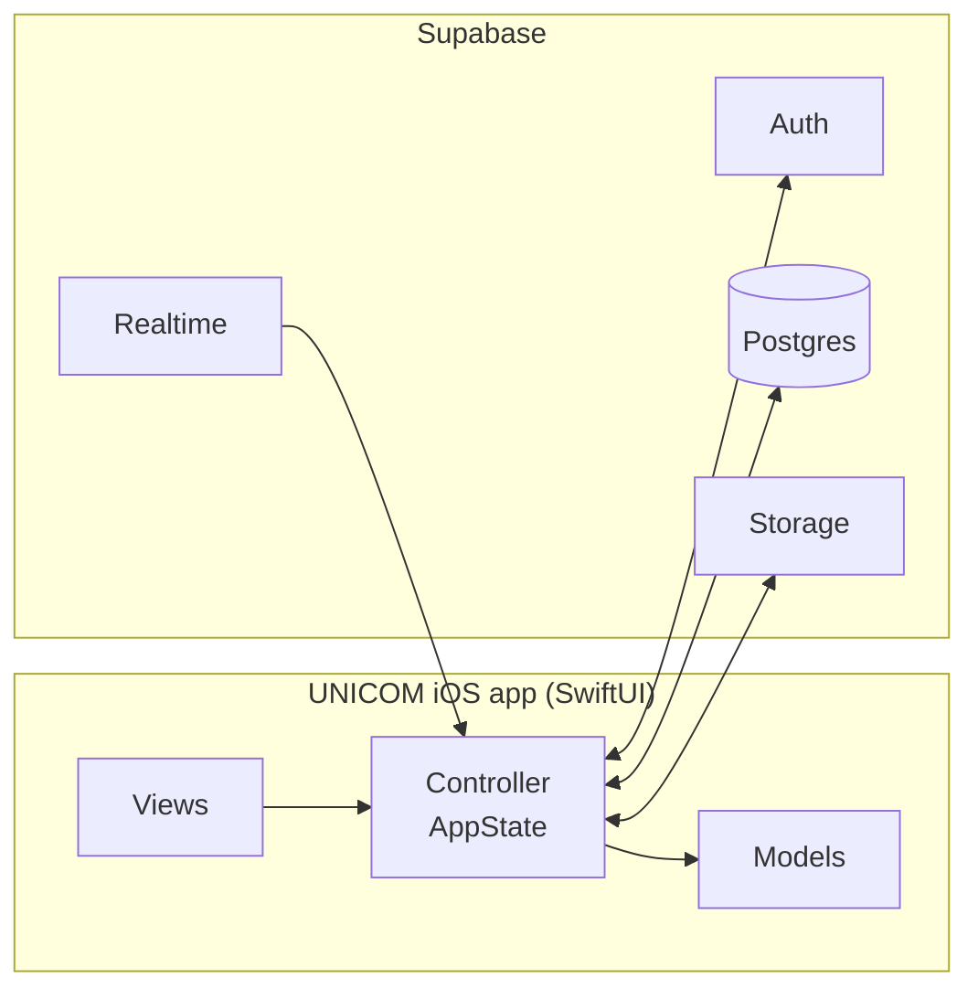

# UNICOM

**A campus-only social app for one university's students, employees and organizations.**

*Everything about the school, in one place.*

UNICOM works like a social feed that only people from the university can join. Students and organizations post recruitment, admins post announcements such as class suspensions, and students ask for what they need, like borrowing a calculator or art materials. Every post has an audience, so a message reaches only the people it is meant for.

[](#tech-stack)
[](#tech-stack)
[](#architecture)
[](#team)

[Setup guide](docs/SETUP.md) · [Architecture](docs/ARCHITECTURE.md) · [Changelog](docs/CHANGELOG.md) · [Run the app](#run-the-app)

---

**Table of contents**

1. [Overview](#overview)
2. [Features](#features)
3. [Who it serves](#who-it-serves)
4. [Tech stack](#tech-stack)
5. [Architecture](#architecture)
6. [Status](#status)
7. [Repository contents](#repository-contents)
8. [Run the app](#run-the-app)
9. [How we build it](#how-we-build-it)
10. [Limitations and next steps](#limitations-and-next-steps)
11. [Disclosures](#disclosures)
12. [Team](#team)

---

## Overview

Campus news is usually scattered across group chats and public pages. UNICOM puts it in one app that only the school community can use.

1. **Sign up** as a **Student** or an **Employee** with your department. A 6-digit code is sent to your email to prove it is you.
2. **Read the feed.** See what is happening now, featured organizations and posts from the whole campus.
3. **Post and reply.** Share an announcement, ask for help, or join the conversation with likes and comments.
4. **Message people** directly and get notifications as things happen.

## Features

| Area | What you can do |
|---|---|
| **Accounts** | Sign up as Student or Employee, choose a department, enter course and year (students) or position (employees), verify with an emailed 6-digit code, change your password |
| **Feed** | Main feed, Happening Now cards, post detail, search for people, and a filter sheet to sort by Latest, Most like or Most comment and to limit by All, Today, This week or This month |
| **Posting** | Write a post with a photo, choose its audience (**Campus**, **Social** or **Organization**), like, dislike and comment |
| **Photos** | Posts with a photo open full screen |
| **Messaging** | Start a chat, see unread badges (`9+` above nine), live new-message updates |
| **Notifications** | Different pop-up banners for messages, reactions and announcements. Tapping one opens the matching screen |
| **Organizations** | Featured organizations with officers, about section and their own feed |
| **Profiles** | Your profile with department, course and organization ("No Organization" if none), edit profile with birthday picker, and other users' profiles with their posts |
| **Forms** | Application Form Download with a confirmation step, saved as a PDF |

## Who it serves

| User | Gets |
|---|---|
| **Student** | Campus news, a place to ask for what they need, ways to find and join organizations |
| **Employee / faculty** | A direct channel to students, with their office or department on their profile |
| **Organization officer** | A page and a feed to recruit members and share updates |
| **Admin** | Announcements such as class suspensions in Happening Now (built-in examples today, admin posting tools are planned) |

## Tech stack

| Layer | Choice |
|---|---|
| App | Swift 5, **SwiftUI**, iOS (iPhone and iPad) |
| Pattern | Model / View / Controller with one shared `AppState` |
| Backend | **Supabase**: Auth, Postgres, Storage and Realtime |
| Package | [supabase-swift](https://github.com/supabase-community/supabase-swift) 2.55.4 |
| Local alerts | `UNUserNotificationCenter` through `LocalNotifier` |
| Tooling | Xcode, Git and GitHub |

## Architecture



*Views never talk to Supabase directly. They call `AppState`, which owns the data and the network calls.* More detail, the folder map and the list of Supabase tables the app expects are in [docs/ARCHITECTURE.md](docs/ARCHITECTURE.md).

## Status

| Part | State |
|---|---|
| Sign-up, email code check, sign-in, password change | ✅ Working on Supabase |
| Feed, posts, comments, likes | ✅ Working |
| Messaging and notifications with realtime | ✅ Working |
| Profiles, avatar upload, other users' profiles | ✅ Working |
| Post filter and search | ✅ Working |
| Featured organizations | 🚧 Sample data in the app, not in the database yet |
| Built-in demo posts | 🚧 Stored on the device, not in the database |
| Database SQL and row level security policies in this repo | 🚧 Planned |
| App screenshots in this README | 🚧 Planned |
| Admin tools and approval of employee accounts | 🚧 Planned |

## Repository contents

```
UNICOM/                  The app source (SwiftUI)
  Controller/            AppState, Supabase client, notifications, helpers
  Model/                 Data types and sample data
  View/                  Screens and components, grouped by feature
  Assets.xcassets/       Images, logos, avatars, app icon
UNICOM.xcodeproj/        Xcode project
docs/SETUP.md            How to build and run
docs/ARCHITECTURE.md     How the app is organized and what Supabase needs
docs/CHANGELOG.md        What changed and when
.github/                 Issue and pull request templates
```

## Run the app

You need a Mac with Xcode.

```
git clone https://github.com/lowkey-tamad/UNICOM_MobDev.git
cd UNICOM_MobDev
open UNICOM.xcodeproj
```

Wait for Xcode to download the packages, pick an iPhone simulator and press **Run** (Cmd + R). Full steps, using your own Supabase project and fixes for common problems are in [docs/SETUP.md](docs/SETUP.md).

## How we build it

We follow the **Software Development Life Cycle (SDLC)** one phase at a time, and we fix small problems first. Work arrives as issue lists from testing, and each round is written down in the [changelog](docs/CHANGELOG.md).

- Open a **bug report** or **feature request** from the Issues tab.
- Keep each commit to one logical step with a clear message.

## Limitations and next steps

- **Campus only is not enforced yet.** Sign-up checks the email with a 6-digit code, but the app only checks that it contains an `@`. It does not require a university email address.
- **Employee accounts** stay as Student on the server until approved, and the approval tool is not built yet.
- **Sample content.** Featured organizations and demo posts are not stored in the database.
- **No automated tests yet.**

**Next:** put the database SQL and security policies in this repo, add screenshots, move organizations to the database, and build admin tools.

## Disclosures

- **Frameworks and services:** SwiftUI, supabase-swift, Supabase.
- **AI-assisted development:** an AI coding assistant was used for parts of the code, fixes and documentation. The team reviews and is responsible for everything that ships.
- **Sample content:** organization names, officers and demo posts are placeholders.

## Team

Project owner: [@lowkey-tamad](https://github.com/lowkey-tamad)

*Add teammates and their roles here.*

---

**UNICOM** · Mobile Development project · *Everything about the school, in one place.*
