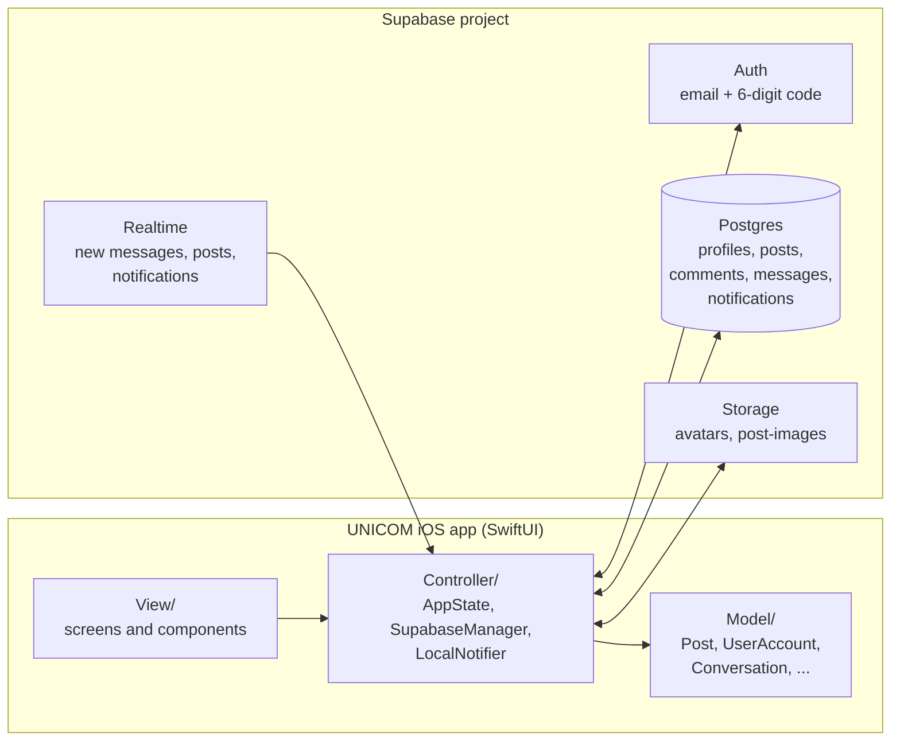

# Architecture

UNICOM is a native **SwiftUI** app. It follows a simple Model / View / Controller split and talks to **Supabase** for accounts, data, files and live updates.



## Folders

```
UNICOM/
  EucomCampusFeedApp.swift   App entry point
  Controller/                AppState (app logic), SupabaseManager (client),
                             LocalNotifier, Formatting, ImageUtils
  Model/                     Data types: posts, accounts, conversations,
                             notifications, organizations, departments, filters
  View/
    Root/                    RootView, RootTabView (Home, Organization, Message, Profile)
    Onboarding/              Onboarding, Login, Sign-up steps, Terms
    Feed/                    Main feed, Happening Now, composer, comments,
                             post detail, search, filter sheet, notifications
    Messaging/               Message list, conversation, new chat
    Organization/            Featured organizations, detail, feed
    Profile/                 Profile, other users' profile, edit, settings,
                             change password, about
    Components/              Post card, avatar, tab bar, image viewer, PDF export, ...
    Theme/                   Colors and styling
  Assets.xcassets/           Images, logos, avatars, app icon
```

## What is live and what is sample data

| Part | State |
|---|---|
| Sign-up, email code check, sign-in, change password | Live on Supabase Auth |
| Profiles and avatar upload | Live |
| Posts, comments and likes from signed-in users | Live |
| Direct messages and notifications, with realtime updates | Live |
| Built-in demo posts (like, dislike, comment) | Sample data stored on the device |
| Featured organizations and officers | Sample data in `SampleOrganizations.swift` |
| Happening Now cards | Built-in content |

## What the app expects from Supabase

This list is read from the code. The SQL that creates these objects is not in this repository yet.

| Kind | Names used by the app |
|---|---|
| Tables or views | `profiles`, `public_profiles`, `posts`, `posts_feed`, `post_votes`, `comments`, `comments_feed`, `messages`, `notifications` |
| Functions (RPC) | `my_conversations`, `mark_conversation_read`, `get_or_create_dm` |
| Storage buckets | `avatars`, `post-images` |
| Auth | Email sign-up with a 6-digit code (`signUp`, `verifyOTP`, `resend`), sign-in, password change |
| Realtime | Inserts on `messages`, `posts` and `notifications` |

Post audiences are **Campus**, **Social** and **Organization**.

## Security notes

- The key in `SupabaseManager.swift` is a **publishable** key. It is meant to be used in client apps, so it is safe to be public **only if row level security (RLS) is turned on** for every table. Check this in the Supabase dashboard.
- Never commit a `service_role` or secret key. `.gitignore` already blocks common secret files.
